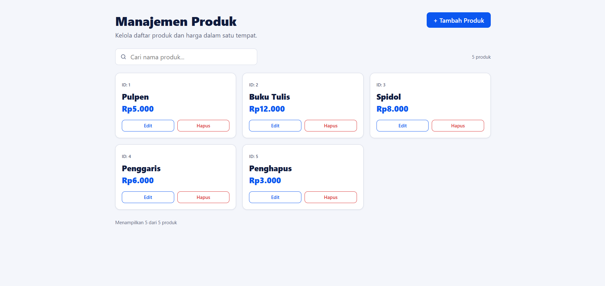
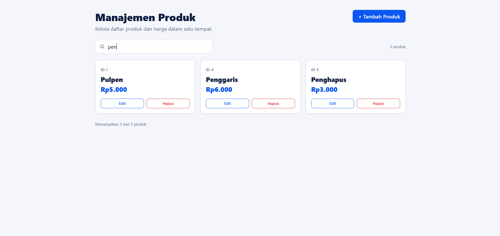
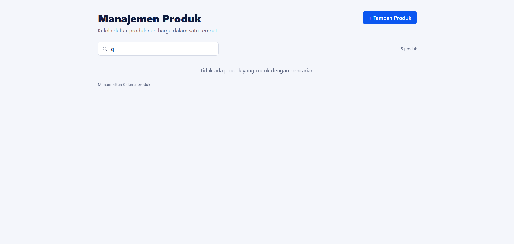
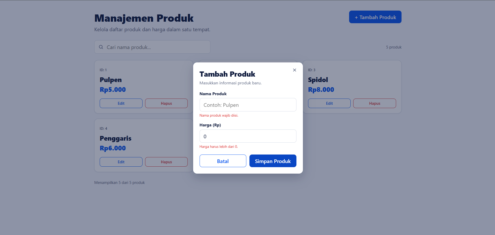
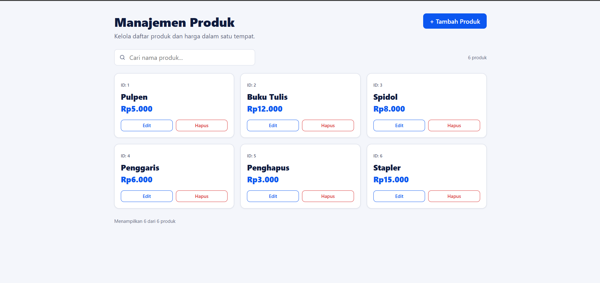
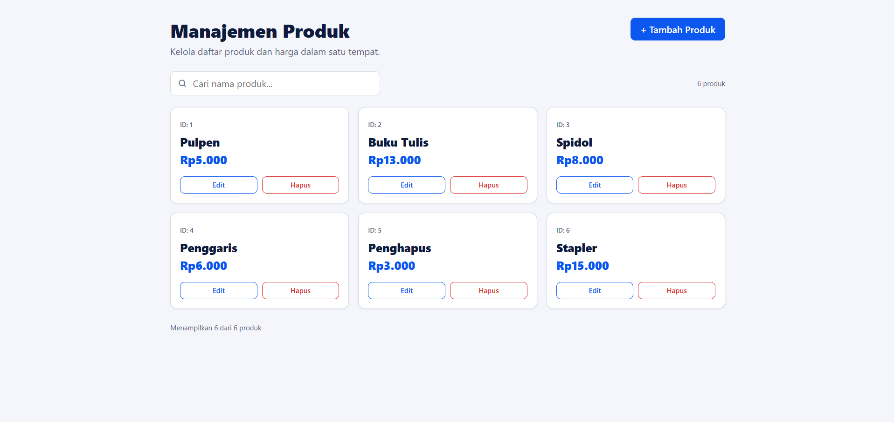
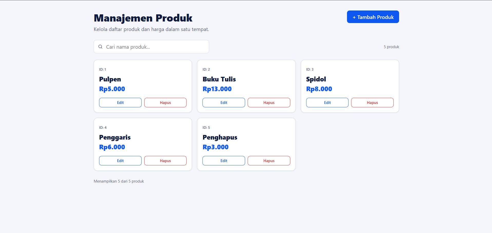
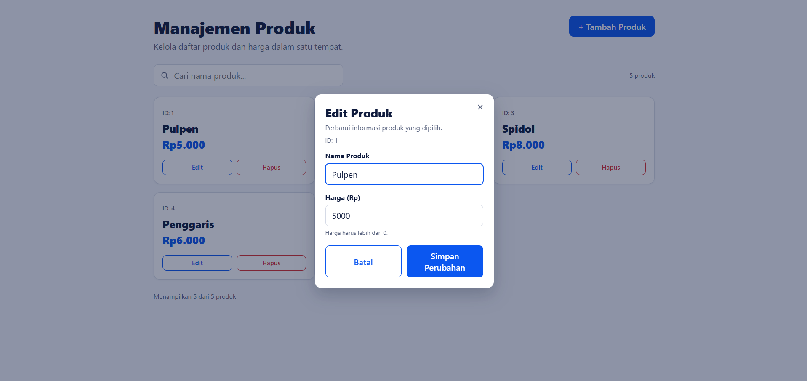

**Judul :** `[Tugas 3] Menambahkan halaman manajemen produk (daftar, cari, tambah, edit, hapus)`

## Ringkasan Perubahan
Membuat aplikasi Manajemen Produk dengan React (Vite) yang sesuai desain:
- Halaman utama menampilkan daftar produk dalam bentuk kartu (ID, nama, harga berformat Rupiah), jumlah produk, dan keterangan "Menampilkan X dari Y produk".
- Pencarian nama produk (input terkontrol, tidak peka huruf besar/kecil).
- Pop-up **Tambah Produk** dengan validasi nama wajib diisi dan harga lebih dari 0.
- Pop-up **Edit Produk** memakai komponen form yang sama dengan data terisi.
- Pop-up **Hapus Produk?** dengan konfirmasi sebelum produk dihapus.
- Event handler dari props (`onEdit`, `onDelete`) diteruskan sebagai referensi fungsi atau arrow function, sehingga baru dijalankan saat tombol diklik, bukan saat render.

## Bukti Pengujian
`npm run build` berhasil tanpa error.

| Skenario | Hasil yang Diharapkan | Hasil Aktual |
|---|---|---|
| Membuka halaman utama | 5 produk tampil, "5 produk" dan "Menampilkan 5 dari 5 produk" |  |
| Mengetik "pen" pada kolom cari | Hanya Pulpen, Penggaris, Penghapus tampil; footer "Menampilkan 3 dari 5 produk" |  |
| Mencari kata yang tidak ada | Muncul pesan tidak ada produk yang cocok |  |
| Tambah produk dengan nama kosong atau harga 0 | Form tidak tersimpan, pesan galat tampil |  |
| Tambah produk "Stapler" harga 15000 | Kartu baru ber-ID 6 muncul, "Rp15.000", jumlah menjadi 6 |  |
| Edit "Buku Tulis" menjadi harga 13000 | Kartu ID 2 berubah menjadi "Rp13.000" |  |
| Klik Hapus lalu Batal | Pop-up tertutup, produk tetap ada |  |
| Klik Hapus lalu Hapus Produk | Produk hilang dari daftar, jumlah berkurang |  |
| Tekan Escape atau klik latar saat pop-up terbuka | Pop-up tertutup tanpa mengubah data |  |